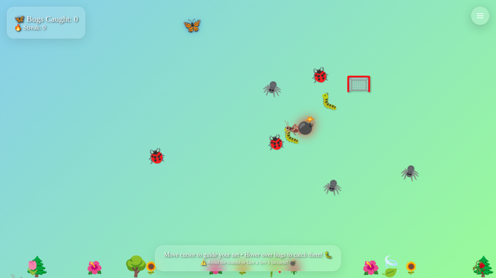
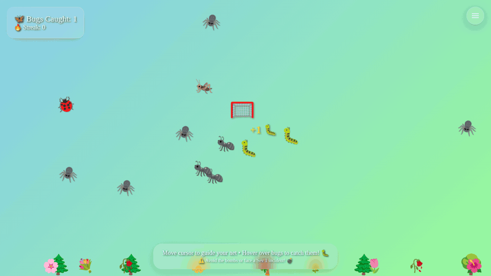

<div align="center">
  <picture>
    <source media="(prefers-color-scheme: dark)" srcset="docs/assets/logo-dark.svg" />
    
  </picture>
  <h1>CatchBugsWithMax</h1>
  <p><strong>An Animal Crossing-style bug catching browser game.</strong></p>
  <p>
    <a href="LICENSE"></a>
    <a href="https://github.com/Manaiakalani/CatchBugsWithMax/actions/workflows/pages.yml"></a>
  </p>
  <p>
    <a href="https://manaiakalani.github.io/CatchBugsWithMax/">Play</a>
    ·
    <a href="#features">Features</a>
    ·
    <a href="#getting-started">Getting started</a>
  </p>
  
  <br />
  
</div>

Drift through a lofi garden, hover to scoop up critters with your net, and keep those corporate Sev 1 bombs out of production.

**How to play:** move your cursor to guide the net (🥅) · hover a bug to catch it · hover a bomb (💣) and the garden becomes a Sev 1 incident.

## What / Why / Try it

| | |
| --- | --- |
| **What** | A cozy, zero-install bug catching game that lives in a single HTML page. Hover to catch. No clicks required. |
| **Why** | A tiny peaceful break: glassmorphism skies, fluttering emoji bugs, and work-life satire when a 💣 slips through the net. |
| **Try it** | [Play on GitHub Pages](https://manaiakalani.github.io/CatchBugsWithMax/) or open [`index.html`](index.html) in any modern browser. No build, no account, no `npm install`. |

The game is a static HTML5 page. After this workflow deploys, it will be live at [https://manaiakalani.github.io/CatchBugsWithMax/](https://manaiakalani.github.io/CatchBugsWithMax/). You can also clone or download the repo and open the file.

## 🎮 How to Play

1. **Guide the net**: your cursor *is* the net.
2. **Hover bugs** to catch them. Commons are 1 point; rares, ultra-rares, and secrets score more.
3. **Avoid bombs** (💣) or the session ends with a dreaded Sev 1 IcM.
4. **Grab power-ups** if they drift by: 🥇 golden net (2× points), 🧲 magnet (more rares), 🛡️ shield (bomb protection).
5. **Open the hamburger menu** (top-right) for dark mode and stats.

## ✨ Features

- **Hover-first controls**: accessibility-friendly catching, no click-spam
- **Dark mode** that remembers your choice (and fireflies after dusk)
- **Catch streaks**, rarity tiers, and a stats panel
- **Responsive glassmorphism UI** with drifting clouds and swaying trees
- **Corporate humor**: one bomb and it's a production incident
- **Pure web stack**: no frameworks, no dependencies, runs offline

## 🛠 Technologies

- **HTML5**: single-page game shell
- **CSS3**: animations, `backdrop-filter` glassmorphism, light/dark themes
- **JavaScript**: vanilla game loop, no libraries
- **Emojis** for the whole art set ✨
- Built with Claude Sonnet 4 as an AI assistant

## 🚀 Getting Started

Open `index.html` in any modern browser. That's the whole setup.

For a local server (optional):

```bash
python3 -m http.server 8000
# then visit http://localhost:8000
```

Or play the hosted copy at [https://manaiakalani.github.io/CatchBugsWithMax/](https://manaiakalani.github.io/CatchBugsWithMax/).

## 📁 Project Structure

```
/
├── index.html    # Game UI with embedded CSS
├── script.js     # Game logic and interactions
├── LICENSE       # MIT License
├── README.md     # You are here
└── docs/assets/  # Logo, screenshot, and gameplay GIF
```

---

*Made with ❤️ in Redmond, WA for peaceful moments and corporate chaos.*
